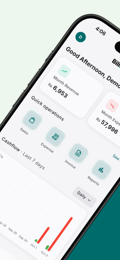
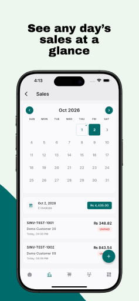
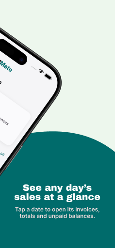
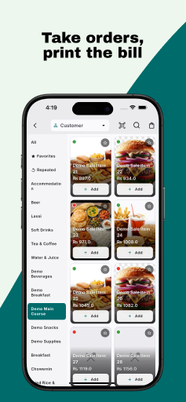
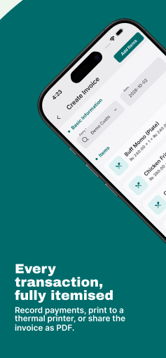
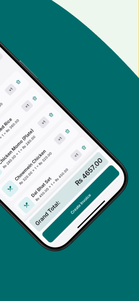
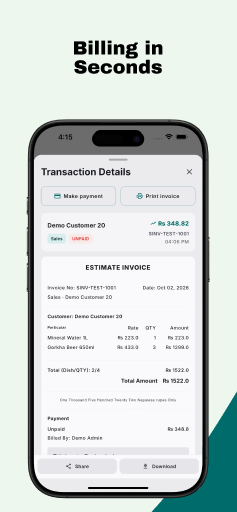
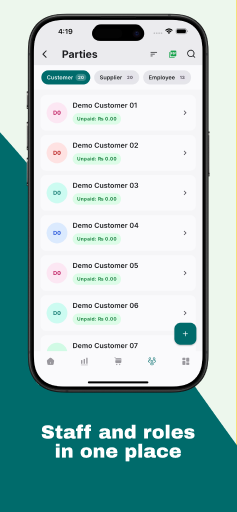
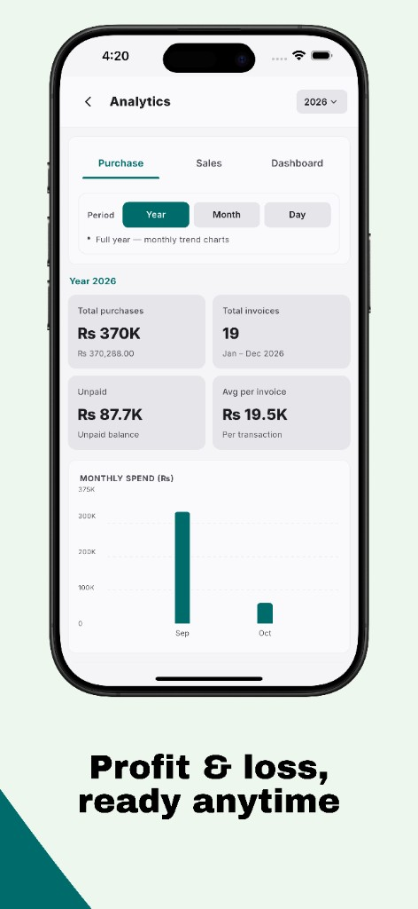

# BillMate

Offline POS for restaurants and shops. Take table orders, bill the check, and run checkout on the device. Sales, purchases, parties, stock, payroll, and day-end books live in a SQLite database, so daily work continues without a server.

BillMate runs on **Android** and **iOS**. The store name is **Offline POS: Billmate Billing**. The Dart package name is `hotel` (`package:hotel/...`).

<p>
  <a href="https://play.google.com/store/apps/details?id=ai.biztrack&hl=en"></a>
  &nbsp;&nbsp;
  <a href="https://apps.apple.com/np/app/offline-pos-billmate-billing/id6807730783"></a>
</p>

| | |
| --- | --- |
| App version | 1.0.0+27 (1.0.0, build 27) |
| Flutter | 3.41.9 stable |
| Dart | 3.11.5 (pubspec allows 3.6.0 and newer) |

User-facing answers for day-to-day use are in [docs/FAQ.md](docs/FAQ.md).

## Screenshots

<p align="center">
  
  
  
</p>

<p align="center">
  
  
  
</p>

<p align="center">
  
  
  
</p>

<p align="center">
  
</p>

## Features

- **Local setup** — organization, country, currency, fiscal year, chart of accounts, and an admin login, created on the device
- **Multiple organizations** — each organization has its own SQLite database
- **Sales and purchases** — invoices, drafts, returns, discounts, tax, and PDF receipts
- **Payments** — partial settlement and splits across cash, card, transfer, and QR
- **Parties** — customers, suppliers, statements, and a default cash customer
- **Items** — categories, units, photos, and barcode scan
- **Stock** — inventory counts, adjustments, and reconciliation
- **People** — employees, roles, attendance, and payroll
- **Day end** — opening float, closing, and daily cash
- **Restaurant** — floor plan, table orders, and KOT
- **Shop** — products, stock, and checkout
- **Liquor calculator** — for Hotel, Restaurant, Hotel & Restaurant, and Bar / Pub
- **Reports** — dashboard, revenue, profit and loss, and statements
- **Print and share** — PDF export and Bluetooth thermal receipts
- **Security** — session login, app lock, and biometrics
- **Languages** — 25 locales, including English, Nepali, Hindi, and Arabic
- **Billing** — freemium limits, with iOS subscriptions through the App Store

Setup asks for a business type. The labels in the app are:

| Type | What it is for |
| --- | --- |
| Restaurant | Dine-in, kitchen & table orders |
| Retail / Shop | Products, stock & checkout |
| Hotel | Rooms, guests & front desk |
| Hotel & Restaurant | Hotel rooms and restaurant together |
| Cafe / Bakery | Coffee, pastries & light bites |
| Bar / Pub | Drinks menu, tabs & bar sales |
| Other | Custom setup |

Default item categories follow the type you pick.

## Tech stack

| Area | Choice |
| --- | --- |
| UI | Flutter, Material, `flutter_screenutil` |
| State | `flutter_bloc` / Cubit |
| Routing | `auto_route` |
| DI | `get_it` + `injectable` |
| Models | `freezed`, `json_serializable`, `equatable` |
| Local data | `sqflite` (books schema in `assets/data/`) |
| HTTP | `dio` (used when a remote API is configured) |
| Config | `flutter_dotenv` (`.env-dev`, `.env-staging`, `.env-prod`) |
| i18n | Flutter gen-l10n (ARB files in `lib/l10n`) |
| Platform services | Firebase (Analytics, Cloud Messaging, Remote Config), Google Sign-In, in-app purchase |

## Architecture

Features live under `lib/src/features/<feature>/` and follow a three-layer split:

```text
presentation/   pages, widgets, Cubits and Blocs
domain/         entities, repositories (contracts), use cases
data/           repository implementations, local and remote data sources, DTOs
```

Shared code sits in `lib/src/core/` (routing, theme, DI, SQLite, currency, billing gates, printing). `lib/bootstrap.dart` starts dependency injection, Firebase, the organization database, and saved preferences before `runApp`.

Entry points:

| File | Env file | Flavor |
| --- | --- | --- |
| `lib/main_development.dart` | `.env-dev` | `development` |
| `lib/main_production.dart` | `.env-prod` | `production` |
| `lib/main_staging.dart` | `.env-staging` | staging flavor is not enabled in Gradle |

## Requirements

- Flutter **3.41.9** stable, with Dart **3.11.5**. `pubspec.yaml` allows Dart `^3.6.0`.
- App version **1.0.0+27**
- Android: API **23+**, JDK **17** for release builds
- iOS: current Xcode and CocoaPods
- A Firebase project if you want Analytics, push, or Remote Config (the app still starts when native Firebase config is missing)

## Getting started

```sh
git clone https://github.com/AkashShrestha31/BillMate-Offline.git
cd BillMate-Offline
flutter pub get
```

Copy the env templates if those files are not already present:

```sh
cp .env-dev.example .env-dev
cp .env-prod.example .env-prod
```

Run a flavor:

```sh
# Development
flutter run --flavor development --target lib/main_development.dart

# Production
flutter run --flavor production --target lib/main_production.dart
```

The same `--flavor` and `--target` pair is used on iOS. Shared Xcode schemes: `development` and `production`. VS Code launch configs are in `.vscode/launch.json`.

First launch walks through language, an optional tour, local organization setup, then login with the admin email and password created during setup.

### iOS pods

```sh
cd ios
pod install
cd ..
```

### Release builds

```sh
flutter build appbundle --flavor production --target lib/main_production.dart
flutter build ipa --flavor production --target lib/main_production.dart
```

Android release signing reads `android/key.properties`. Keep that file and the keystore on your machine. Source releases are git tags named `v*` (see [CHANGELOG.md](CHANGELOG.md)). A manual run of `.github/workflows/release.yml` publishes to Play Console and TestFlight when repository secrets are configured. Pushing a tag does not upload to the stores.

## Configuration

Environment files are bundled as Flutter assets. Keys are documented in `.env-dev.example` and `.env-prod.example`.

| Key | Purpose |
| --- | --- |
| `BASE_URL` | Optional API host. Day-to-day books do not require it. |
| `ANDROID_BILLING_ENABLED` / `IOS_BILLING_ENABLED` | Turn store billing on or off per platform. |
| `IOS_BILLING_DEV_BYPASS` | Skip the iOS paywall in development. |
| `*_PRODUCT_MONTHLY` / `YEARLY` / `LIFETIME` | Store product ids. |
| `FREEMIUM_*` | Free-tier limits and which modules require premium. |

Firebase on device uses files you add locally. They are gitignored:

- Android: `android/app/src/<flavor>/google-services.json`
- iOS: `ios/Config/<Flavor>/GoogleService-Info.plist`

The iOS build continues without that plist. Analytics, push, and Remote Config start after you add your own Firebase files. A bundled force-update sample lives in `assets/config/force_update_policy.json`.

### Do not publish secrets

These must stay out of a public repository and out of git history:

- Firebase **Admin SDK** JSON (service account private keys)
- Android keystores (`*.jks`) and `android/key.properties`
- Play Store and App Store API keys, Fastlane `.env` files with tokens
- Any real `BASE_URL` or third-party API secret

`google-services.json` and `GoogleService-Info.plist` identify a Firebase project. Use a project you control, and rotate keys that have already been committed before the repo goes public.

## Project structure

```text
lib/
  main_development.dart
  main_production.dart
  main_staging.dart
  bootstrap.dart
  firebase_options.dart
  l10n/                      ARB sources and generated localizations
  src/
    app/                     root widget
    core/                    DI, routes, theme, SQLite, billing, printing
    features/                feature modules (invoice, party, setup, ...)
assets/
  data/                      books SQL, chart of accounts, currencies
  l10n/                      language list
  images/  icons/  svg/  fonts/
android/  ios/               flavors, Firebase, Fastlane
docs/FAQ.md
docs/screenshots/          README images
```

Feature modules include `invoice`, `expense`, `party`, `dashboard`, `reports`, `employee`, `payroll`, `opening`, `closing`, `stock_adjustment`, `reconciliation`, `order`, `table`, `billing`, `backup`, `setup`, and `org`.

## Code generation

Routes, Freezed models, JSON serializers, and Injectable registrations are generated. After changing annotated code:

```sh
dart run build_runner build --delete-conflicting-outputs
```

Watch mode:

```sh
dart run build_runner watch --delete-conflicting-outputs
```

## Localization

UI strings use [Flutter internationalization](https://docs.flutter.dev/ui/accessibility-and-internationalization/internationalization). The template is `lib/l10n/app_en.arb`. Locales are listed in `l10n.yaml` and `assets/l10n/languages.json`.

1. Add the key to `lib/l10n/app_en.arb` (and the other `app_*.arb` files).
2. Regenerate:

```sh
flutter gen-l10n
```

3. Read it with `AppLocalizations.of(context)`.

## Tests

```sh
flutter test
flutter analyze
```

## Contributing

1. Fork the repository and create a branch from the default branch.
2. Keep changes inside the feature you are touching: presentation, domain, and data stay separated.
3. Run `dart run build_runner build --delete-conflicting-outputs` when you change generated types.
4. Run `flutter analyze` and `flutter test`.
5. Open a pull request that explains the user-facing change and how you tested it.

Please do not commit keystores, service-account JSON, or signing properties.

## License

[MIT](LICENSE) © 2025–2026 Akash Shrestha. You can use, modify, and distribute this project, including in commercial apps, as long as the copyright notice and license text stay with the code.
